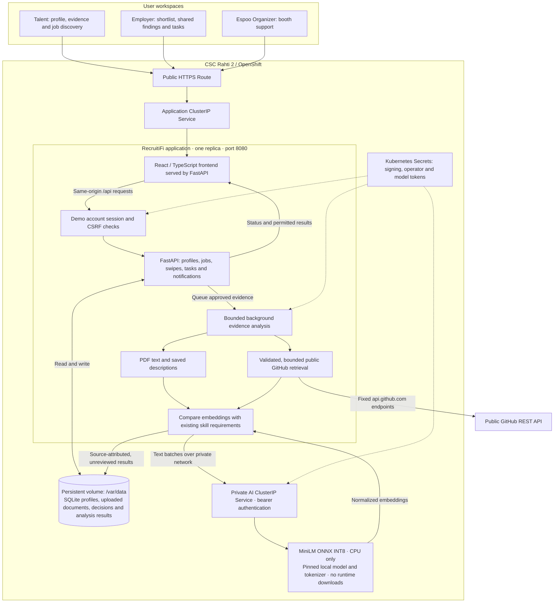

# RecruitiFi

**Skill-based talent discovery with private AI evidence analysis.**

RecruitiFi connects Talent and Employers through mobile-first job discovery,
professional profiles, and source-attributed evidence analysis. Built for the
City of Espoo use case, it combines a React interface, a FastAPI application,
persistent SQLite storage, and a separately hosted MiniLM inference service.

[Open the application](https://recruitifi-recruitifi-demo.2.rahtiapp.fi/) ·
[Local development](#local-development) · [AI analysis](#private-ai-evidence-analysis) ·
[Deployment](#deployment) · [Validation](#validation)

> **Shared demonstration environment.** The public deployment allows visitors to
> select configured Talent, Employer, and Organizer accounts without a password.
> Visitors can switch accounts and modify shared data. Use fictional profiles and
> synthetic documents only; account selection does not establish private ownership.

## Capabilities

| Workspace | Capabilities |
| --- | --- |
| Talent | Maintain skills, documents and professional links; filter jobs by industry; swipe or use Interested / Rejected controls; analyze selected evidence; view hiring tasks and submit response links. |
| Employer | Manage company requirements, select a job, explore anonymous candidate cards, shortlist Talent, review permitted evidence, and assign or verify hiring tasks. |
| Espoo Organizer | Review booths that may need support and refresh employer eligibility information. |
| Shared interface | Mobile touch gestures, centered reaction controls, keyboard navigation, undo, notifications, responsive layouts, and accessible loading/error states. |

Discovery decisions are **company-level**: swiping one job applies the same choice
to that company's other openings. Mutual interest creates a match notification;
meeting acceptance remains subject to the existing eligibility and review checks.
Notifications refresh after relevant actions and poll every 12 seconds while the
Talent or Employer workspace is active.

## Architecture



**How to explain the flow:** Visitors select a workspace through the HTTPS Route.
FastAPI serves the interface and handles application requests. When Talent selects
evidence and confirms permission, a background worker extracts bounded text or
retrieves approved public GitHub content. The private MiniLM service returns
embeddings; the application compares them with existing skill requirements and
stores attributed results in SQLite. The frontend polls for status and displays
permitted findings.

**Deployment boundaries:** The application and model run in separate containers.
The model has no public Route, and its bearer token stays server-side. SQLite and
uploaded documents live on the PVC so they survive application Pod recreation.
Public demo account selection remains shared access; cookies and CSRF checks do
not turn it into private identity authentication. LinkedIn pages are not fetched;
the separate completion bonus is described below.


| Layer | Implementation |
| --- | --- |
| Frontend | React 19, TypeScript, Vite 7, Tailwind CSS 4 |
| Application | FastAPI, Uvicorn, Python 3.11+ |
| Persistence | SQLite; uploaded files are stored as database BLOBs |
| Extraction | Local PDF text extraction with `pypdf` |
| Embeddings | `sentence-transformers/all-MiniLM-L6-v2`, ONNX INT8, CPU execution |
| Hosting | CSC Rahti 2 / OpenShift; application and internal model service use separate images |

The main production image serves the compiled frontend and API on port **8080**.
Model weights are packaged into the separate AI image during its build. Runtime
inference uses local artifacts and does not call external AI providers.

## Local development

### Requirements

- Python 3.11 or newer for the application.
- Node.js **22.12+**; the production build uses Node.js 22.
- **pnpm 10.28.0**, matching the Docker build, and `frontend/pnpm-lock.yaml`.
- Docker with linux/amd64 build support for optional container validation.
- Prepared model artifacts and a separate model environment for AI-enabled use.

Install the pinned package manager if it is not already available:

```sh
npm install --global pnpm@10.28.0
```

Run the following from the repository root on macOS or Linux:

```sh
python3 -m venv backend/.venv
source backend/.venv/bin/activate
python -m pip install -r backend/requirements.txt

# Insert missing fictional records; preserve existing records with the same IDs.
python -m backend.seed --add-only
python -m backend.seed_jobs

python -m uvicorn backend.main:app --host 127.0.0.1 --port 8000 --reload
```

In PowerShell, create the environment with `python -m venv backend/.venv` and
activate it with `backend/.venv/Scripts/Activate.ps1`; the remaining Python
commands are the same.

In a second terminal:

```sh
cd frontend
pnpm install --frozen-lockfile
pnpm dev
```

Open **http://localhost:5173/**. Local API documentation is available at
**http://127.0.0.1:8000/docs**.

Vite proxies `/api` requests to port 8000. Keep `VITE_API_URL` empty for this
same-origin setup so browser sessions and CSRF checks use the expected origin.
The basic setup supports profile and discovery workflows; AI analysis and
session-protected hiring tasks require the account/model configuration below.

**Data initialization:** `backend.seed` without `--add-only` updates existing seed
records. Do not use it to upgrade a populated event or a Rahti database. The
optional `--include-practice` flag adds a larger fictional directory; it does not
create additional selectable account aliases.

### Run with the private model

First prepare the isolated runtime and pinned artifacts using the
[embedding service instructions](experiments/local_model/service/README.md).
Benchmark background and Linux/amd64 measurements are in
[the model experiment](experiments/local_model/README.md) and
[the Linux/amd64 report](experiments/local_model/RESULTS_LINUX_AMD64.md).

Stop the plain Uvicorn process, activate the backend environment, and run:

```sh
python experiments/run_local_evidence.py
```

Keep Vite running in the other terminal. The launcher starts the API on
`127.0.0.1:8000` and the private model on `127.0.0.1:8081`. It requires the existing
`experiments/local_model/.venv` and prepared model files; it performs no downloads
or dependency installation. It reuses `backend/talentmatch.sqlite3` without
resetting or reseeding it. Ctrl+C stops both services.

The launcher maintains distinct local account passwords and signing/service
secrets in a private temporary directory outside Git. It prints the credentials
file location, retains existing passwords between runs, and does not change Rahti
credentials. Model binaries, credentials and virtual environments belong outside Git.

To preview explicit password-free account selection locally:

```sh
TALENTMATCH_PASSWORD_FREE_DEMO=true python experiments/run_local_evidence.py
```

PowerShell equivalent:

```powershell
$env:TALENTMATCH_PASSWORD_FREE_DEMO = "true"
python experiments/run_local_evidence.py
```

This enables shared account selection while retaining server-issued cookies and
CSRF checks. The optional reset and additional jobs remain a separate operation;
starting the launcher does not apply them.

## Private AI evidence analysis

The Talent panel labelled **Our Own Private Model** uses a privately hosted
MiniLM service. Its pinned model revision is
`1110a243fdf4706b3f48f1d95db1a4f5529b4d41`.

1. Add documents or links through **Documents & links**.
2. Select up to three saved resources and confirm permission to analyze them.
3. Optionally enable the existing Employer 001 sharing choice.
4. Select **Analyze My Profile** and review the resulting job relevance and source details.

Analysis runs in bounded background workers. The interface polls while work is
active and stops on terminal states or unmount. Changes to evidence, skill claims,
or job requirements invalidate cached results and require an explicit new analysis.

### Supported evidence

| Material | Analysis behavior |
| --- | --- |
| CV, project, certificate or research PDF | Extracts readable text locally, without OCR. |
| Project or other saved description | Uses the supplied title/description where supported. |
| Public GitHub repository | Retrieves selected README, manifest and source files through the fixed GitHub API host. |
| Public GitHub profile | Retrieves public biography and a bounded sample of recent non-fork repository metadata. |
| LinkedIn profile | Adds the separately labelled completion bonus described below; profile pages are not fetched. |
| Personal website or other external link | Uses saved metadata/descriptions; external pages are not fetched. |
| PNG or JPEG upload | Uses the saved description; image contents are not analyzed. |

PDF extraction is limited to **10 pages**, **20,000 extracted characters**, and
**10 MiB input**. A profile analysis accepts at most three materials totalling
10 MiB and uses up to six bounded text fragments. Scanned, encrypted, malformed,
or unreadable files produce explicit errors rather than fabricated evidence.

GitHub retrieval uses bounded requests, disables redirects, and never clones or
executes repository code. Selection is limited to three repositories, 20 files,
20,000 bytes per file, and 100,000 bytes of decoded text. Private repositories,
blocked content and rate limits are reported explicitly. Retrieved repository text
is not stored in full; results retain short attributed excerpts and source references.

The embedding service accepts batches of 1–3 strings with a maximum of 256 tokens
per string. It uses one inference thread with bounded admission. Missing model
files, unavailable services, overload and timeouts produce explicit failures.

### Interpreting results

- **AI evidence fit** is weighted semantic relevance between selected evidence and
  existing job skill requirements. Findings remain **unreviewed**; percentages do
  not establish proficiency, authorship, qualification or hiring probability.
- A selected valid LinkedIn profile link adds **+2 profile-completion points** to
  a completed score, capped at 100. The UI labels this **combined fit** and preserves
  the original MiniLM score. Bonuses do not stack, and a LinkedIn link alone cannot
  produce an evidence analysis.
- Adding a self-declared skill does not verify it or automatically improve AI
  evidence coverage. Analysis does not write detected skills into candidate claims.
- The existing rule-based engine remains available for compatibility APIs and
  operational eligibility. Language, visa/relocation rules and meeting thresholds
  continue to use their existing checks.

Extraction, retrieval, embeddings and persistence are implemented under
[`backend/evidence/`](backend/evidence/). The model service lives separately under
[`experiments/local_model/service/`](experiments/local_model/service/).

## Accounts and access modes

| Account aliases | Mapping |
| --- | --- |
| `talent-001`–`talent-015` | Original 15 seeded Talent profiles; mappings are defined in `backend/demo_accounts.py`. |
| `talent-ai-001` | Optional constant fictional AI test profile, candidate `900001`. |
| `employer-001`–`employer-005` | Companies 1–5. Other companies remain discoverable. |
| `organizer-001` | Espoo Organizer workspace. |

The application reads account availability from SQLite. A missing profile is
unavailable and is never silently replaced. Accounts, uploads and decisions are
shared demonstration records, not independently verified real-user identities.

Password-free account entry requires the explicit
`TALENTMATCH_PASSWORD_FREE_DEMO=true` setting. Password mode remains the default
for configured account sessions. Signed cookies are HttpOnly, SameSite=Strict,
Secure over HTTPS, and scoped to `/api`; write requests retain origin and CSRF
validation. Switching access mode invalidates cookies issued in the other mode.

The hosted HTTP Basic gate is a separate setting. Disabling it alone does not
enable password-free AI sessions. Public mode lets anyone select any configured
account, including an Employer with sharing access. Legacy shared API routes and
caller-selected demo headers do not provide confidential account isolation.

**Real applicant data requires production identity, authorization, consent,
retention and operational controls beyond this demonstration setup.** Keep operator
and model-service tokens server-side; do not place them in React, Vite variables,
browser storage, source control, or images.

## Deployment

The CSC Rahti release verified on **15 November 2026**, commit **`54fe443`**, includes
password-free account entry, the mobile-first UI, and **62 fictional jobs**: the
12 initial openings plus 50 additional positions. The release performed a one-time
Talent skill/swipe reset while preserving uploads, accounts and Employer decisions.
The interface reads actual counts from the current database.

| Resource | Deployment configuration |
| --- | --- |
| Main application | One replica; `Recreate` strategy; frontend and API on port 8080. |
| Persistent database | `/var/data/talentmatch.sqlite3` on the existing PVC; uploaded documents remain in SQLite. |
| Model service | Separate CPU-only Deployment and ClusterIP Service; no public Route. |
| Public entry | OpenShift HTTPS Route with HTTP-to-HTTPS redirect. |
| Runtime identity | Arbitrary non-root UID, read-only application filesystem, writable PVC and `/tmp`. |
| Secrets | Server-side account, signing, operator and embedding credentials; retained when public access is enabled. |

The existing deployment backup was retained on Rahti as requested; it was not
downloaded. A backup on the same PVC shares the volume's failure risk. Follow an
approved off-volume backup policy before treating this as a durable recovery plan.

Start with the [Rahti runbook](deploy/rahti/README.md),
[internal AI deployment guide](deploy/rahti/ai/README.md), and
[public-demo preparation procedure](deploy/rahti/PUBLIC_DEMO_PREP.md).
Some linked documents describe earlier preparation phases; the deployment snapshot
above records the release verified for this README.

The public-demo procedure uses `backend.demo_release` for an explicit, backed-up,
transactional reset and job addition. A completion marker prevents repeated runs
from erasing new activity or duplicating jobs. It is never invoked at startup.
Do not reseed a populated deployment or delete the PVC to update the application.

Build the main image locally:

```sh
docker buildx build --platform linux/amd64 --load -t recruitifi:local .
```

The Dockerfile builds the frontend with the frozen pnpm lockfile and installs the
backend requirements under the deployment constraints file. Keep model artifacts
in the separate AI build context. Existing alternative Render configuration is
retained in [`render.yaml`](render.yaml); the private AI service and its credentials
require their own configuration.

### Configuration reference

| Variable | Purpose |
| --- | --- |
| `TALENTMATCH_DB` | SQLite path; defaults to the local backend directory, set to `/var/data/talentmatch.sqlite3` on Rahti. |
| `TALENTMATCH_SERVE_FRONTEND` | `1` enables serving built frontend assets; set by the production image. |
| `TALENTMATCH_HOSTED_DEMO` | `1` enables hosted-demo configuration. |
| `TALENTMATCH_DEMO_AUTH_ENABLED` | Hosted Basic authentication: defaults to `true`; `false` explicitly disables the gate. |
| `TALENTMATCH_DEMO_PASSWORD` | Hosted Basic password, required while that gate is enabled; obtain from a Secret. |
| `TALENTMATCH_PASSWORD_FREE_DEMO` | Defaults to `false`; `true` permits public selection of configured accounts. |
| `TALENTMATCH_VERIFIED_DEMO_LOGIN` | Set to `1` for the server-session account-entry flow. |
| `TALENTMATCH_AI_DEMO_ACCOUNTS` | Secret JSON map of configured aliases to distinct demo passwords; retained in public mode. |
| `TALENTMATCH_AI_SESSION_SECRET` | Independent server-side cookie-signing secret. |
| `TALENTMATCH_AI_DEMO_TOKEN` | Server-only operator token for the evidence pipeline. |
| `TALENTMATCH_AI_JOB_MATCHING` | `1` enables profile-to-job AI analysis. |
| `TALENTMATCH_AI_CONSENTED_MODE` / `TALENTMATCH_AI_CANDIDATES` | Enable selected-material consent mode and define the operator-approved candidate allowlist. |
| `TALENTMATCH_AI_SYNTHETIC_DEMO` / `TALENTMATCH_AI_SYNTHETIC_CANDIDATES` | Alternative explicitly synthetic analysis mode and allowlist. |
| `TALENTMATCH_AI_EMPLOYER_ACCESS` | Server-side company/candidate sharing grants; explicit material consent also governs access. |
| `TALENTMATCH_AI_FETCH_PUBLIC_PROFILES` | GitHub profile retrieval defaults to `1`; `0` disables it. |
| `TALENTMATCH_EMBED_URL` / `TALENTMATCH_EMBED_INTERNAL_HOST` | Approved loopback or fixed internal embedding endpoint; Rahti uses `http://recruitifi-ai:8080/embed` and `recruitifi-ai`. |
| `TALENTMATCH_EMBED_TOKEN` | Server-side bearer secret shared by the application and model service. |
| `TALENTMATCH_PUBLIC_ORIGIN` | Exact trusted HTTPS application origin for hosted session/CSRF checks. |
| `PORT` | Application listener port; the container launcher defaults to 8080. |

See the deployment guides for complete combinations, Secret creation and rollback.
Never copy production credentials into a frontend environment file.

## Validation

From an activated backend environment and the repository root:

```sh
python -m unittest discover -s backend -t . -p 'test_*.py'
pnpm --dir frontend test
VITE_API_URL='' pnpm --dir frontend build
```

The frontend build performs TypeScript validation before producing assets. On
PowerShell, set `$env:VITE_API_URL = ""` before the build command.

Optional browser checks require an existing Python Playwright installation,
Chromium, and a running local Vite server:

```sh
python frontend/tests/mobile_ui_check.py
```

These checks mock all API traffic with synthetic data and cover touch controls,
swipe versus scrolling, centered reactions, failed-save recovery, dropdowns,
checkbox alignment, notifications, and startup retries at phone, tablet and desktop
sizes. They do not modify the application's database.

For synthetic analysis checks against the already configured local model:

```sh
python experiments/profile_analysis_e2e.py --password-free-demo
```

Set the loopback `TALENTMATCH_EMBED_URL` and server-side `TALENTMATCH_EMBED_TOKEN`
in the test process first. The script creates a disposable database and never
uses the application's candidate documents.

The [CI workflow](.github/workflows/ci.yml) defines backend tests on Python 3.11
and 3.13, frontend tests/build, and linux/amd64 container persistence checks. Its
frontend job currently uses the checked-in npm lockfile; the Docker build uses
the pnpm lockfile and version documented above.

Container persistence and arbitrary-UID validation are described in
[`deploy/rahti/test_container.py`](deploy/rahti/test_container.py) and the Rahti
runbook. The latest deployed release passed 310 backend tests, 54 frontend tests,
the production build, responsive Chromium touch checks, and a live analysis of
the constant fictional project. This is demonstration validation; real production
readiness requires a separate security and operational assessment.

## Repository guide

| Path | Responsibility |
| --- | --- |
| `frontend/src/` | Workspaces, swipe cards, profile forms, notifications and loading states. |
| `frontend/tests/` | Frontend regression tests and optional synthetic browser checks. |
| `backend/main.py` | FastAPI application, startup, health and static serving. |
| `backend/database.py` / `backend/schema.sql` | SQLite connection handling and additive schema definitions. |
| `backend/profile_materials.py` | Material metadata, uploads, downloads and profile skill updates. |
| `backend/evidence/` | Extraction, GitHub retrieval, model client, analysis jobs, sessions and result storage. |
| `backend/demo_release.py` | Explicit one-time public-demo data preparation. |
| `experiments/local_model/` | Model preparation, benchmarks and separate inference service. |
| `deploy/rahti/` | OpenShift manifests, deployment procedures and operational checks. |

Keep feature changes scoped, run the relevant checks, and preserve existing event
data. Commit application source and documentation only; keep credentials, SQLite
files, uploaded documents, model binaries and local environments out of Git.
